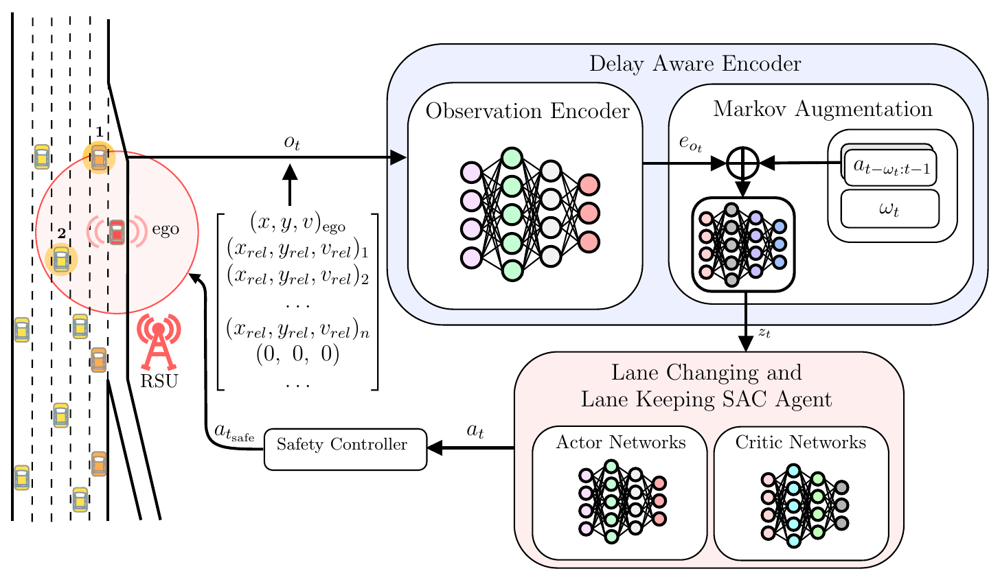

# DAROM: Delay-Aware Reinforcement Learning for Highway On-Ramp Merging

**DAROM** (Delay-Aware Reinforcement learning for On-ramp Merging) is a framework for autonomous highway on-ramp merging under stochastic V2I communication latency. The agent is modeled as a Random Delay Markov Decision Process (RDMDP) and trained with a Delay-Aware Encoder that jointly processes delayed observations, masked action histories, and delay magnitudes to recover the true latent traffic state.

## Overview

In RSU-assisted autonomous driving, the roadside unit (RSU) perceives surrounding vehicles and transmits state estimates to the ego vehicle over V2I links. Processing and transmission introduce stochastic delays, violating the Markov assumption and degrading standard RL performance. DAROM addresses this by:

- **RDMDP formulation**: Models the problem as a Random Delay MDP via state augmentation with the delayed observation, action buffer, and delay magnitude.
- **Delay-Aware Encoder**: A GRU-based encoder that implicitly infers the current latent state from the augmented input.
- **Physics-Based Safety Controller**: A supervisory layer that enforces kinematic stopping distance constraints, overriding unsafe actions before execution.
- **Unified SAC Agent**: A single soft actor-critic agent for joint longitudinal and lateral control.

Experiments in SUMO using real-world NGSIM traffic data show DAROM-GRU achieves **>99% success** in high-density traffic with random delays up to 2.0 seconds. The trained policy generalizes across five stochastic delay distributions (uniform, bimodal, bursty, triangular, exponential) without retraining.



## Repository Structure

```
DAROM/
├── src/
│   ├── merging.py           # SUMO-based merging environment (gymnasium)
│   ├── wrapper.py           # DelayWrapper — RDMDP state augmentation
│   ├── delay_encoder.py     # Delay-Aware Encoder (MLP / GRU / Transformer)
│   ├── safety_controller.py # Physics-based safety controller
│   └── utils.py             # Shared utilities
├── sumo_files/              # SUMO network and route files (Easy/Medium/Hard)
├── models/
│   └── GRU-uniform-delay/   # Pretrained DAROM-GRU checkpoint
├── train_sac_delay.py       # Training script
├── evaluate_sac_delay.py    # Evaluation script
├── config.yaml              # Environment configuration
└── requirements.txt
```

## Git Submission Policy

The root `.gitignore` uses an allowlist. Only `src/`, `assets/`,
`sumo_files/`, `sumo_new/`, `models/`, and the explicitly listed root files
are eligible for new Git tracking. New root files or directories must be
added to the allowlist intentionally. Under `models/`, only the two existing
pretrained checkpoints in `GRU-uniform-delay/` are allowed.

AI workspace directories (`.codex/`, `.claude/`, `.cursor/`, `.agents/`),
local agent instructions (`AGENTS.md`, `CLAUDE.md`), temporary directories
(`tmp/`, `temp/`, `scratch/`, `artifacts/`), caches, credentials, and generated
training or simulation output are ignored even within allowed directories.
Store AI scratch work in these ignored directories: ordinary files placed
directly in an allowed source or asset directory can still be tracked.

Before committing, inspect `git status --short` and `git diff --cached`.
Ignore rules do not affect files already tracked by Git, and `git add -f`
can bypass them.

## Installation

**Requirements**: Python 3.10+, [SUMO](https://sumo.dlr.de/) ≥ 1.18

```bash
# Clone the repository
git clone https://github.com/<your-username>/DAROM.git
cd DAROM

# Create and activate virtual environment
python -m venv .venv
source .venv/bin/activate

# Install dependencies
pip install -r requirements.txt

# Set SUMO_HOME (add to ~/.bashrc for persistence)
export SUMO_HOME=/usr/share/sumo
```

## Antwerp traffic routes

`sumo_new/Antwerp_easy.rou.xml`, `Antwerp_medium.rou.xml`, and
`Antwerp_hard.rou.xml` define 1-hour background demand of 1,800, 3,456,
and 7,108 vehicles, respectively. To run one scenario, pass its route file
to SUMO, for example:

```bash
sumo -c sumo_new/Antwerp.sumocfg --route-files sumo_new/Antwerp_hard.rou.xml
```

The origin mix, vehicle lengths, and OD seed come from the Antwerp detector
data on 2022-09-05 from 11:30 to 12:30. Matched trajectories are balanced
to observed origin counts and to the proportions of the three mapped exit
counts. Detector `3849` (`L4e`) has no verified D1/D2/D3 mapping in the
three-exit network; its observations are retained in origin totals, and
their destinations are projected onto the three mapped exits. The four
vehicle types use the paper's disjoint length ranges; cars and vans are
combined because the supplied length data cannot separate them. Each
scenario includes one `ego` trip at SUMO time 120 s from O3 to D1 using the
same `car_van` type as the traffic flow. One O3-to-D1 `car_van` was removed
from each flow, so the 1-hour vehicle and OD totals are unchanged.
The route file defines ego's trip and vehicle type for both pure SUMO and
training. Pure SUMO leaves its lane and speed decisions to SUMO; the training
environment instead applies `laneChangeMode=0` at departure and sends explicit
acceleration and lane commands through TraCI.
`src.merging.Merging(seed=579071, scenario="easy")` loads one of the
`easy`, `medium`, or `hard` Antwerp routes (`medium` by default). Each reset
advances SUMO to just before the scheduled departure, then waits for `ego`
to actually enter O3. The episode clock starts at takeover and has a uniform
limit of 6,000 control steps (600 simulated seconds at 0.1 s per step);
arrival at D1 can end it earlier. `reset()` returns the actual departure
time in `info`. The environment starts SUMO from the network and selected
route files with the timing and lateral settings of `Antwerp.sumocfg`,
without detector outputs. The observation uses ego route distance, lane
index, and speed, with nearby vehicles expressed in the ego's forward/left
coordinate frame. Reward and
safety checks use the same coordinate convention. Lane changes are
bounded by each Antwerp edge's actual lane count; merging is
recognized when ego leaves `E75_0` for a mainline lane or reaches `E76`.
The existing pretrained policy must be retrained for this observation layout.
The task is for ego to merge safely and reach D1 before the episode limit;
collision, emergency stopping, and timeout are failures. Background queues
are recorded as scenario conditions, not optimized away by changing traffic
demand or network throughput. The existing network speed limit is 13.89 m/s
and remains unchanged for this stage.

## Training

Train DAROM-GRU from scratch:

```bash
python train_sac_delay.py \
    --scenario hard \
    --delay_mode uniform \
    --encoder_mode GRU \
    --run_name GRU-hard-uniform-delay \
    --save_dir models_experiments/antwerp-hard \
    --wandb_mode disabled
```

Use the same scenario when evaluating a checkpoint in a separate process.
The safety controller is disabled by default; pass `--safety` to enable it.
DAROM-GRU is the default encoder for new training runs.
The pretrained checkpoint under `models/` is kept unchanged.
The Antwerp GRU scales route progress and local neighbor coordinates before
encoding, reads masked actions from oldest to newest, and outputs 256 features.
Models trained with the earlier GRU input convention should be retrained.

For a controlled Table IV input ablation, keep `--encoder_mode GRU` and choose
`--ablation` from `full`, `delayed_state_only`, `delayed_state_delay`,
`delayed_state_action`, or `linear_predictor`. All five preserve the 134-value
GRU input. Missing action-history or delay fields are zeroed; the linear
predictor advances each neighbor's relative longitudinal position by its
relative velocity times the received delay and exposes no history or delay to
the policy. This keeps the architecture fixed while changing available
information. The safety controller still receives the unmasked delayed state.
Use the same `--safety` setting for all five runs and pass the matching
`--ablation` value to independent evaluation. Training and evaluation both
default to `full`, with safety disabled. New checkpoints store these two
settings, and evaluation rejects a mismatch. Legacy checkpoints without the
stored settings need manual matching.

## Antwerp migration checklist

This checklist tracks the working baseline. Mark an item complete only after
its code and validation are both in place; keep unresolved assumptions visible
when comparing results with the [DAROM paper](https://arxiv.org/html/2403.11852)
and [upstream code](https://github.com/amin-tabrizian/DAROM).

**Completed**

- [x] Add Antwerp network and easy/medium/hard one-hour OD routes with four
  vehicle types in `sumo_new/` (1,800 / 3,456 / 7,108 vehicles).
- [x] Place one `car_van` ego on O3 to D1 at SUMO time 120 s in each route,
  replacing one background O3-to-D1 car without changing total demand.
- [x] Start the episode when ego actually enters O3; cap it at 6,000 control
  steps after takeover, with arrival, collision, and emergency-stop outcomes.
- [x] Replace old-world-axis observation logic with ego-forward/left local
  coordinates for up to 30 neighbors; use route distance for ego progress.
  Adapt lane-change bounds, merge recognition, reward gaps, and safety checks
  to the Antwerp observation layout.
- [x] Select the nearest 30 vehicles within the observation radius before
  applying the existing left/forward spatial order. Hard traffic reached 37
  candidates in a full probe; a separate 2,501-step run verified the selected
  states at all 113 over-capacity steps without changing the 31×3 shape.
- [x] Connect the training entry to all three routes. Training disables the
  safety controller by default; `--safety` enables it. New checkpoints go to
  `models_experiments/`.
- [x] Separate evaluation from training: training saves numbered checkpoints
  every 100,000 steps without starting a second SUMO environment in the same
  process. Run `evaluate_sac_delay.py` separately for Antwerp outcome metrics;
  checkpoints are no longer labeled "best" before evaluation.
- [x] Carry the ego's merge status in each environment step. Independent
  evaluation retains the total `Max Steps` count and splits it into `No Merge
  Timeout` and `Merged Timeout`; training logs separate episode indicators for
  arrival, collision, emergency stopping, and both timeout types. A TraCI
  probe checked no-merge timeouts in all three densities and an Easy arrival
  after merging.
- [x] Match the upstream Table IV outcome proxy: success is `Arrived`, collision
  is `Collision`, and reported no-merge rate counts **all** `Max Steps` episodes.
  The merged/unmerged timeout split remains diagnostic because the Antwerp route
  continues beyond the merge. Emergency stopping stays separate and is not
  silently folded into the paper's three rates; if it occurs, those rates need
  not sum to 100%.
- [x] Adapt the safety controller's target-lane filter to Antwerp geometry.
  It now projects the selected lane centerline into ego's local frame for both
  lane changes and lane keeping, accounting for lateral movement and heading.
  In three-density TraCI probes this
  eliminated the observed misses of `E75_1` vehicles during the O3 merge;
  fixed-action comparisons reached a mainline lane with `--safety` in all
  three scenarios before ego lane-mode restoration and again under lane
  mode 0. These probes do not establish a trained policy's safety.
- [x] Connect the five Table IV input ablations to Hard-scenario training and
  independent evaluation. All retain the GRU input shape and separate safety
  input; five 3-step training and evaluation smoke runs loaded their matching
  temporary checkpoints, and a masked-input safety-wrapper smoke run completed.
  A separate 102-step linear-predictor run exercised training beyond SAC's
  default initial exploration period. These runs do not measure convergence or
  task success.
- [x] Align the GRU action-history length with the wrapper's 20-action buffer.
  The upstream training script used `max_delay + 1`, which mismatches that
  buffer's length.
- [x] Give delay sampling an independent RNG keyed by the experiment seed and
  episode index. An explicit `reset(seed=S)` restarts episode 0; later resets
  without a seed advance the index. All five delay modes now replay for the
  same seed without consuming SUMO's or global NumPy's random stream.
- [x] Check the legacy 32 m/s ego guard against Antwerp speeds. With seed
  579071 and a continuous +5 acceleration command, ego reached D1 in all
  three scenarios under the previous automatic lane mode; its maximum speed
  was 14.36 m/s and the guard never fired. Recheck route completion under the
  current lane mode before using these runs as reachability evidence.
- [x] Check ego acceleration against its `car_van` type. All three routes set
  `accel=2.6` and `decel=4.5`; an Easy-scenario TraCI probe measured +2.6
  m/s² from a +5 command and −4.5 m/s² from a −5 command, without an
  emergency-stop outcome.
- [x] Restore the upstream ego-only lane-control setting. The original DAROM
  disables SUMO's autonomous ego lane changes with `laneChangeMode=0`; Antwerp
  now does the same while retaining the `car_van` type and speed mode 31. A
  same-seed TraCI probe showed no spontaneous lane changes under mode 0 and
  confirmed that an explicit policy lane request still works in the E75 merge
  zone. A new 3-step Hard training smoke run saved a checkpoint successfully.

**Retained choices and recorded differences**

- Detector `3849 / L4e` has an unverified exit mapping: its counts
  remain in the demand totals and its destinations are projected to D1/D2/D3.
  Revisit only if a verified detector-to-exit mapping becomes available.
- Keep the current 120 s ego departure, 6,000-step episode limit,
  13.89 m/s network speed limit, and Hard-scenario background queues until
  measurements justify a change. The objective is ego reaching D1, not
  removing congestion from the network.
- Keep the 32 m/s guard as an untriggered legacy condition in the tested runs.
  The ego's `car_van` type has a 45 m/s maximum and SUMO speed mode 31; its sampled
  speed factor of 1.034 makes the effective speed limit about 14.36 m/s on
  13.89 m/s lanes. One internal connector is limited to 12.51 m/s. Recheck
  the guard if road limits or speed mode change; this probe does not establish
  the speed behavior of a trained policy.
- Keep the four Antwerp vehicle types and their SUMO parameters as the traffic
  baseline. The original `f_1`/`f_2` overrides targeted particular lane flows;
  Antwerp flow IDs represent scenario/OD/type and do not match those checks.
  Do not assign the old overrides to Antwerp types or invent a driver-profile
  ratio. The current `SetTrafficBehavior` checks therefore have no effect on
  Antwerp background vehicles; a sampled `car_van` retained `tau=1.0`, type
  maximum speed 45 m/s, and speed mode 31. Define any driver-profile groups
  separately if a future experiment needs them.
- Upstream also sets ego `speedMode=96`, but Antwerp keeps `speedMode=31` and
  the `car_van` acceleration/deceleration values. Changing lane mode does not
  change these physical parameters; the upstream speed-mode difference remains
  deliberate and should be evaluated separately. SUMO lane mode 0 also skips
  gap-safety checks for explicit TraCI lane requests, so policy collisions and
  the optional safety controller must be assessed under this setting.
- The policy action range remains −5 to +5 m/s². SUMO limits realized ego
  acceleration to the `car_van` type values in the measured probe, while the
  existing jerk reward uses the commanded action. Keep this reward convention
  for upstream comparison; review it before changing model behavior.
- The current Antwerp GRU is a **documented deviation**, not an exact copy
  of upstream: the upstream encoder reads its
  newest-first action buffer without reversal and uses 128 output features;
  the current encoder reverses that buffer, scales its inputs, and outputs 256
  features. The separate MLP encoder still receives unscaled inputs. These
  differences are recorded without changing the current code. Follow upstream
  model behavior as the reference for further migration; discuss any new
  model-behavior change separately before implementing it.
- The distributed checkpoint under `models/` is not an Antwerp result; the
  observation meaning and GRU interface have changed.
- Unlike upstream's global NumPy delay draws, Antwerp uses a separate seeded
  delay stream for reproducibility; the five distribution rules are unchanged.

**Pending work**

- [ ] Evaluate the trained Antwerp policy with `--safety` before claiming a
  collision reduction. The fixed-action probes cover merge behavior, not
  complete policy episodes or all delayed-observation cases.
- [ ] Select the best Antwerp checkpoint using independent evaluation across
  the required scenarios and delay profiles; no checkpoint has been ranked yet.
- [ ] Build and train the five Hard-scenario Table IV variants under a stated
  common safety-controller policy. Report success, collision, no-merge, and
  return using the outcome proxy above; keep emergency stops and the timeout
  split visible beside the table rates. Generate the corresponding Fig. 5
  training curves. No full Antwerp model training or Table IV evaluation has
  been completed yet.
- [ ] Train and evaluate the `full` baseline and five variants at a sufficient
  budget under ego lane mode 0; the pre-restoration pilot checkpoints used
  SUMO's automatic lane mode and cannot measure the revised policy task.
  A new 10,000-step `full` pilot and three-density fixed-action/safety probes
  have completed under lane mode 0, but the pilot is not a Table IV result.
- [ ] Assess route-aware lane guidance after the policy-controlled baseline.
  `E77_0` connects only to D3; `E82_0`–`E82_2` connect to
  D2, while `E82_3`–`E82_5` connect to D1. One pre-restoration training episode
  ended with an ego emergency stop on `E77_0`; its per-step lane actions were not
  recorded, so the source of that lane choice is unknown. Keep emergency stops
  separate from collision and timeout counts.
- [ ] Distinguish ego teleportation from an uninterrupted D1 arrival in future
  evaluations, and reassess the 6,000-step limit using complete non-teleported
  trajectories. Do not count merely entering D1 as an `Arrived` episode.
- [x] Run an initial scripted end-to-end controller under the same TraCI ego
  takeover settings as training. Easy and Medium completed without ego
  teleportation in both current- and delayed-observation probes; none of four
  Hard seeds did. Pure SUMO validates native driving behavior, while these
  probes validate the policy action interface and expose Hard-scenario limits.
- [ ] Diagnose why the initial rule misses target lanes or remains in Hard
  queues before using it as a comparative baseline. Keep the fixed difficult
  seeds, and distinguish rule limitations from road congestion.

**Validation so far:** unit tests cover ego selection, geometry, wrappers,
and encoder input handling. All three Antwerp scenarios reset at 120.1 s
with a 134-value augmented observation (93 vehicle values + 40 action-history
values + one delay value). A controlled delay-wrapper probe confirmed current
ego values, delayed neighbors, newest-first masked actions, and matching
observation-space dtype/shape. A five-step GRU/SAC prediction in Antwerp Easy
completed after reset. A SUMO probe reproduced the same 12 delay draws after
resetting twice with one seed and a different sequence after changing it.
These are interface checks, not evidence of training
convergence or task success.

A Hard/uniform/no-safety pilot with seed 579071 trained each Table IV input
variant for 256 steps (156 SAC updates). One complete independent episode per
variant at seed 579072 ended in `Merged Timeout`; this is a pipeline check, not
a variant ranking. A separate `full` baseline trained from scratch for 10,000
steps (9,900 updates). Its three independent complete episodes at seeds
579072–579074 yielded two D1 arrivals and one merged timeout, with no ego
collision or emergency stop. Three episodes are insufficient for a Table IV
performance claim; pilot models and logs remain under `tmp/ai/`.
All of these checkpoints were trained before ego lane mode 0 was restored, so
their arrival rates are historical and must not be treated as current results.

Deterministic traces of the 10,000-step `full` checkpoint at seeds 579073 and
579074 show a parsed lane-change action of zero on every step. SUMO still
changed the ego's lane: the successful episode moved from `E82_1` to `E82_3`
and reached D1, while the timeout moved from `E78_1` to `E78_0` and then
entered `:J107_0_0`. There it advanced only 72 m over nearly 3,000 steps;
between steps 3,500 and 4,500 its stopped leader was a D1-bound car with a
near-zero gap. The immediate timeout mechanism was a downstream queue, and
the current pilot does not demonstrate learned lane-changing behavior.
With the same old checkpoint and seed 579073 under lane mode 0, the policy
again issued zero lane-change actions, SUMO made no within-edge lane changes,
and ego timed out on `E78_0`. This is a control-attribution check, not a fair
performance comparison across training conditions.

Under lane mode 0, fixed `+1` lane commands merged into the mainline in Easy,
Medium, and Hard with the safety controller both disabled and enabled (seed
579071, 800-step probe). With safety enabled, fixed lane-keeping did not merge
within 500 steps in any density. These probes check the merge-control path,
not D1 arrival or policy safety. A new Hard/uniform/no-safety `full` pilot
trained from scratch for 10,000 steps. Three independent complete episodes
at seeds 579072–579074 produced zero D1 arrivals, one ego collision, and two
merged timeouts, with no ego emergency stop. In the collision episode, the
model issued two consecutive `+1` lane commands on `E82` (steps 2322–2323);
SUMO reported an ego collision during lane change at step 2339. This small
pilot demonstrates a policy-control failure, not a stable success rate or a
comparison with the earlier automatically changing-lane checkpoint. The
checkpoint, probe logs, and trace remain under `tmp/ai/lane-control-audit/`.

Full traces of the two merged timeouts separate their causes. At seed 579073,
ego remained on `E78_0` from step 2627 to the 6,000-step limit; it advanced
about 64 m in the final 1,000 steps and spent 82% of those steps below 1 m/s.
The model issued no lane-change commands on E78, so it had neither reached
E82 nor moved toward an E82 lane that connects to D1. At seed 579074, ego
spent about 3,100 steps on `:J107_0_0`, with speed below 1 m/s for 97% of
that interval. SUMO teleported it at simulation time 699.3 s from the jammed
connector to `E82_3`; this was not a policy-controlled lane change. It then
entered D1, but timed out 106 m before the D1 endpoint at simulation time
720 s. The model issued no lane-change commands on E78 or E82 in this run.
The observed delays include a downstream queue; simply extending max steps
would not establish uninterrupted ego completion or learned D1 lane choice.

A separate pure-SUMO reference used the same network, scenario routes,
0.1 s step, lateral resolution, and mapped SUMO seeds without TraCI or a model.
Ego departed at 120 s; each run was observed until simulation time 900 s.

| Scenario | Environment seed | Ego result | Ego teleported? |
|---|---:|---|---|
| Easy | 579071 | Arrived at 303.0 s | No |
| Medium | 579071 | Arrived at 320.9 s | No |
| Hard | 579071 | Arrived at 364.8 s | No |
| Hard | 579072 | Still unfinished at 900 s | No |
| Hard | 579073 | Arrived at 653.6 s | Yes, at 622.9 s |
| Hard | 579074 | Arrived at 318.9 s | No |

Thus the O3-to-D1 network is traversable with SUMO's autonomous driving in
multiple demand realizations, but Hard can also queue long enough to prevent
completion or require a teleport. These runs do not establish convergence of
the RL policy or feasibility under TraCI's ego-only lane mode 0. Outputs are
kept under `tmp/ai/pure-sumo-baseline/`.

A temporary scripted controller then reused `evaluate_sac_delay.make_env` with
the same scenario, seed, 120.1 s ego takeover, 0.1 s action step, 6,000-step
limit, `car_van` type, ego lane mode 0, speed mode 31, and default safety
controller disabled. It requested one lane at a time through the existing
action interface, checked neighbor gaps, and kept SUMO's collision and
teleport behavior unchanged. Both observation variants used the same static
O3-to-D1 target-lane map. The current-observation variant read the environment's
31-vehicle state; the delayed variant read the uniform-delay policy observation
from `DelayWrapper` (up to 20 steps). Ego state remained current in both.

| Scenario | Seed | Current observation | Delayed observation |
|---|---:|---|---|
| Easy | 579071 | Arrived, 199.3 s, no teleport | Arrived, 215.0 s, no teleport |
| Medium | 579071 | Arrived, 217.0 s, no teleport | Arrived, 217.0 s, no teleport |
| Hard | 579071 | Timeout at J107 connector | Timeout on D1 after ego teleport |
| Hard | 579072 | Timeout on E78_2 | Timeout on E82_0 |
| Hard | 579073 | Timeout on E78_2 | Timeout on E77_3 |
| Hard | 579074 | Timeout on E78_2 | Ego collision at J107 connector |

Times are simulated seconds after takeover. `Arrived` counts as success only
without an ego teleport. The rule also reads current edge/lane position and
an explicit lane-connectivity map, information not explicitly supplied to the
RL observation; these are engineering diagnostics, not a fair Table IV
comparison or evidence that delay compensation helps. The first exact-TraCI-
neighbor version of the rule also completed Easy and Medium but no Hard seed
without teleportation. The temporary script and per-seed logs, including
lane requests, transitions, final route distance, and stop counts, remain
under `tmp/ai/rule-baseline/`.

**Key arguments:**

| Argument | Options | Description |
|---|---|---|
| `--delay_mode` | `uniform`, `bimodal`, `bursty`, `triangular`, `exponential` | Delay distribution during training |
| `--scenario` | `easy`, `medium`, `hard` | Antwerp traffic scenario; defaults to `medium` |
| `--safety` | flag | Enable the safety controller (disabled by default) |
| `--encoder_mode` | `GRU`, `MLP`, `Transformer` | Delay-Aware Encoder architecture |
| `--ablation` | `full`, `delayed_state_only`, `delayed_state_delay`, `delayed_state_action`, `linear_predictor` | Table IV input variant; non-full variants require GRU |
| `--run_name` | string | WandB run name |
| `--save_dir` | path | Directory to save model checkpoints |

## Evaluation

Evaluate a newly trained Antwerp checkpoint in a separate process:

```bash
python evaluate_sac_delay.py \
    models_experiments/antwerp-hard/GRU-hard-uniform-delay/GRU-hard-uniform-delay_100000_steps.zip \
    --scenario hard --delay-mode uniform --episodes 51
```

Pass `--safety` only when evaluating a run trained with the safety controller.
Pass the same `--ablation` value used to train that checkpoint.
The script reports D1 arrival, collision, timeout, emergency stopping, and mean
return. Each episode gets a distinct seed for SUMO and delay sampling, so the
same checkpoint and evaluation seed reproduce the episode delay sequences.

Numbered checkpoints are saved every 100,000 training steps under
`models_experiments/<run_name>/`. The latest model is also saved as
`models_experiments/<run_name>.zip` at training completion. Neither is marked
"best" until independent evaluation compares them.

## Pretrained Model

A pretrained DAROM-GRU checkpoint is provided in `models/GRU-uniform-delay/`. The model was trained exclusively on the uniform delay distribution and evaluated zero-shot on all five distributions.

Use `GRU-uniform-delay_best` for evaluation.

## Results

Performance on Hard traffic mode (1,374–1,490 vph/lane) with random delays up to 2.0s:

| Method | Success (%) | Collision (%) | Avg. Return |
|---|---|---|---|
| MPC | 83.10 ± 1.47 | 16.70 ± 1.47 | — |
| DRL-ORMOC | 90.09 ± 0.86 | 9.78 ± 0.81 | 138.90 ± 0.20 |
| No Encoder | 97.41 ± 0.68 | 0.13 ± 0.13 | 161.15 ± 2.08 |
| **DAROM-GRU** | **99.80 ± 0.23** | **0.00 ± 0.00** | **179.68 ± 0.51** |

Generalization across delay distributions (trained on uniform only):

| Delay Profile | Success (%) | Collision (%) | Avg. Return |
|---|---|---|---|
| Uniform (train) | 99.80 ± 0.23 | **0.00 ± 0.00** | 179.68 ± 0.51 |
| Bimodal | **100.00 ± 0.00** | **0.00 ± 0.00** | 180.03 ± 0.06 |
| Bursty | **100.00 ± 0.00** | **0.00 ± 0.00** | 180.01 ± 0.03 |
| Triangular | **100.00 ± 0.00** | **0.00 ± 0.00** | 180.01 ± 0.07 |
| Exponential | **100.00 ± 0.00** | **0.00 ± 0.00** | **180.04 ± 0.04** |

## Citation

If you use this code, please cite:

```bibtex
@misc{tabrizian2024darom,
  title={Delay-Aware Reinforcement Learning for Highway On-Ramp Merging under Stochastic Communication Latency},
  author={Tabrizian, Amin and Huang, Zhitong and Aziz, Arsyi and Wei, Peng},
  year={2024},
  eprint={2403.11852},
  archivePrefix={arXiv},
  primaryClass={cs.RO},
  doi={10.48550/arXiv.2403.11852},
  url={https://arxiv.org/abs/2403.11852}
}
```

## Acknowledgements

This work is supported by the National Science Foundation Award #2229885. Traffic demand and vehicle speed data are derived from the [NGSIM US Highway 101 dataset](https://www.fhwa.dot.gov/publications/research/operations/07030/).
